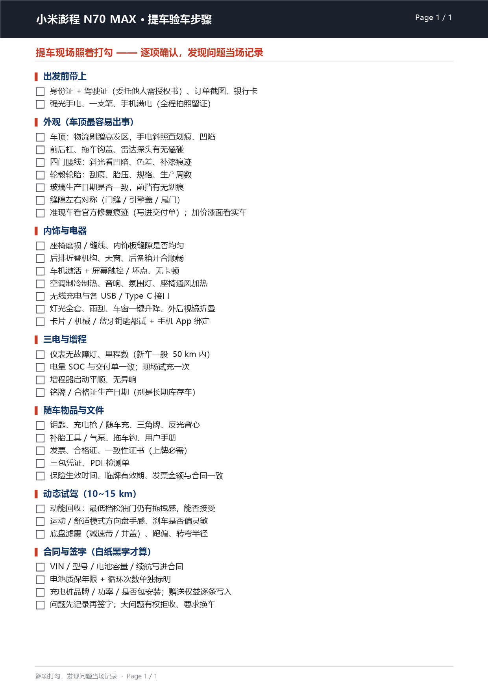

# print-checklist.ps1

Turn a JSON checklist into a printable **A4 sheet** — with real tick boxes, a coloured group
header bar, a dark header strip and a page footer — then preview it as PNG, send it to a printer,
or export it as PDF.



## Usage

```powershell
pwsh -File print-checklist.ps1 examples/vehicle-inspection.json                    # preview PNGs
pwsh -File print-checklist.ps1 examples/vehicle-inspection.json -Mode print        # default printer
pwsh -File print-checklist.ps1 examples/vehicle-inspection.json -Mode print -Copies 4
pwsh -File print-checklist.ps1 examples/vehicle-inspection.json -Mode print -PrinterName "EPSON1234 Series"
pwsh -File print-checklist.ps1 examples/vehicle-inspection.json -Mode pdf          # export PDF
```

| parameter | meaning |
|---|---|
| `-Spec` | path to the JSON checklist (positional) |
| `-Mode` | `preview` (default) / `print` / `pdf` |
| `-PrinterName` | any installed printer; omit to use the Windows default |
| `-Copies` | how many identical copies of the whole document to print |
| `-OutDir` | where preview images / the PDF are written (default: current directory) |
| `-Dpi` | preview resolution (default 150) |

`-Mode preview` never touches a printer, and it reports the content height of every page and
flags overflow — so you find out that a list does not fit **before** spending paper.

## The spec

One page in `pages` gives you a one-page checklist (the common case); several pages give you a
multi-page document. `-Copies` then repeats the whole thing.

```json
{
  "title":  "Packing list · summer camp",
  "footer": "tick as you pack",
  "layout": "compact",
  "pages": [
    {
      "theme": "Friday morning",
      "blocks": [
        { "head": "Documents", "items": ["ID card", "Insurance card", "Booking printout"] },
        { "head": "Clothes",   "items": ["3 t-shirts", "Rain jacket"] }
      ]
    }
  ]
}
```

* `title` — the line inside the dark header strip.
* `theme` — the red sub-heading under the header (optional).
* `layout` — `compact` (tighter, fits more lines: the default) or `roomy`.
* Every string is free text; CJK, emoji-free punctuation and mixed scripts are fine.

## The trap this script exists to avoid

`GraphicsUnit.Display` sounds harmless. It is not, because it means **two different things**:

| drawing surface | what `Display` means |
|---|---|
| a printer (`PrintDocument`) | 1/100 inch |
| a bitmap (your preview) | **one pixel** |

So the *same* drawing code at the *same* font sizes produces two different layouts: the preview
claims the list overflows the page while the printer would have been fine — or, worse, the other
way round. It goes further than positions: `Font.GetHeight()` and `Graphics.MeasureString()` also
switch units, so line wrapping and vertical spacing are computed differently on each surface.

The fix is to pick a physical unit and use it everywhere:

```powershell
$g.PageUnit = [System.Drawing.GraphicsUnit]::Point   # A4 = 595 x 842 pt
```

Then a preview rendered into a 150-dpi bitmap and the printed sheet are the same layout, and
`preview` becomes a trustworthy gate for `print`.

One leftover oddity: `PaperSize` still takes **1/100 inch** (`827 x 1169` for A4). It predates
`PageUnit` and never joined the rest of the API, so the constants in this script deliberately use
two different units — that is not a bug.

## Notes

* Windows + PowerShell 7. Drawing is done by `System.Drawing` (GDI+). Nothing is installed and
  nothing is downloaded.
* Tick boxes are drawn as rectangles rather than `□` glyphs: a drawn box stays square and prints
  crisply at any size, and it survives font substitution.
* Text wrapping is done by measuring **every character**, because `DrawString` does not wrap text
  into a width unless you hand it a rectangle and a trimming format — which in turn breaks the
  hanging indent used here.
* The font is chosen from the first available of
  `Microsoft YaHei → Microsoft YaHei UI → Segoe UI → SimSun → Arial`, so CJK content does not fall
  back to tofu boxes.
* `-Copies N` prints N copies of the document, not N copies of the last page — for a one-page spec
  they are the same thing, which is exactly why it is worth saying.
* If you edit the script: the parameter is `$Spec` and the parsed document is `$doc`, and those two
  names are different **on purpose**. PowerShell variable names are case-insensitive, so naming the
  parsed object `$spec` would assign it to the `[string]$Spec` parameter — the type constraint then
  silently stringifies it back into JSON text, and every property lookup returns `$null` (the
  symptom is a blank page, not an error). This is not hypothetical: it is how the first version of
  this file behaved.

## License

MIT — see [../LICENSE](../LICENSE).
